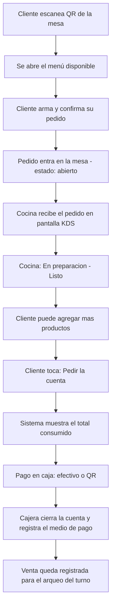
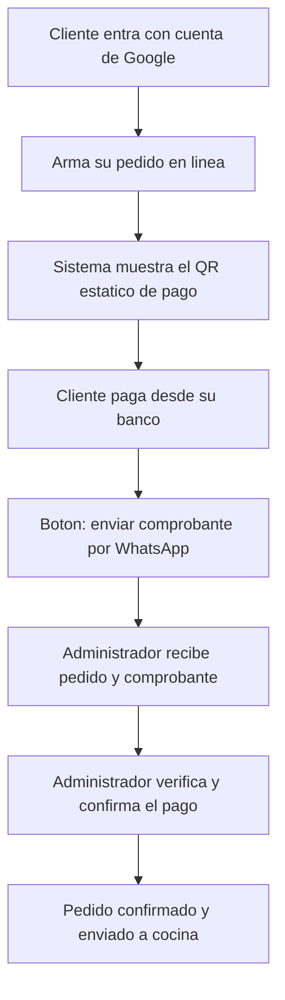

# Casa Rosa — Definición del Software

**Tipo de producto:** Sistema de gestión y pedidos para cafetería y pastelería
**Modalidad recomendada:** Aplicación web responsiva (PWA) — el cliente NO instala nada, solo escanea y ordena
**Idioma:** Español
**Contexto:** Bolivia (pagos por QR bancario + efectivo, WhatsApp como canal principal)

---

## 1. Visión del producto

Casa Rosa es una plataforma que conecta **el salón, la cocina y la caja** en tiempo real, y que además permite **pedidos en línea**. Su sello distintivo es el **pedido autónomo desde la mesa por código QR**: el cliente escanea, ve el menú disponible en ese momento, ordena, la cocina lo recibe al instante y al final pide la cuenta y paga.

El sistema debe lograr tres cosas a la vez:
1. Que **nada se venda sin quedar registrado** (para que el arqueo de caja cuadre siempre).
2. Que el cliente viva una experiencia **rápida, moderna y bonita** (acorde a la marca "Casa Rosa").
3. Que el administrador tenga **control total** del stock, los precios, las ventas y los pagos.

---

## 2. Roles de usuario

> **Roles dinámicos:** los roles base se describen abajo, pero el sistema debe permitir que el **administrador cree nuevos roles y asigne permisos** desde su panel (no quedan fijos en código). El administrador tiene **acceso total** y puede actuar como cualquier rol (cajera, cocina) cuando haga falta.

| Rol | Qué puede hacer |
|-----|-----------------|
| **Administrador** | Acceso total. Crea/edita productos, categorías, precios y combos. Crea mesas y genera sus QR. Crea otros roles y asigna permisos. Registra gastos. Ve todas las ventas, hace y revisa el arqueo de caja. Confirma pagos de pedidos en línea. Gestiona reservas. Ve el dashboard y reportes. Puede modificar/eliminar órdenes ya enviadas a cocina. |
| **Cocina** | Ve la pantalla de pedidos entrantes (KDS) en tiempo real, por mesa. Marca pedidos como "En preparación" y "Listo". |
| **Cajera / Mesera** | Ve las cuentas abiertas por mesa, cierra pedidos, registra el cobro y **anota la vía (efectivo o QR)**. Abre y cierra la caja del día. Atiende el aviso de "Cobrar" de las mesas. Registra gastos. A pedido del cliente, puede modificar/eliminar una orden ya enviada a cocina. |
| **Cliente** | Ordena **como invitado** escaneando el QR de su mesa (sin login), **o** entra en línea con cuenta de Google, arma su pedido, paga por QR (Yape) y envía su comprobante. Puede reservar mesa. |

> Nota: el cliente **no** edita ni cancela su orden por su cuenta una vez enviada a cocina; debe solicitarlo a la cajera/administrador, que habilita el cambio.

---

## 3. Módulos funcionales

### 3.1 Inventario / Menú por categorías
- Registrar productos (nombre, descripción, foto, precio, categoría).
- Clasificar por **categorías** (ej.: Cafés, Pastelería, Bebidas frías, Salados, Postres). El admin crea/edita/elimina categorías.
- Control de stock simple: marcar producto como **disponible / agotado** a mano (esto es lo que controla qué ve el cliente en el menú).
- *Por ahora NO se maneja control por cantidades* (no descuenta unidades). Queda como mejora futura.
- Cada producto es **un ítem fijo con un solo precio** (sin variantes de tamaño/opciones por ahora).

### 3.2 Menú digital
- Se genera **automáticamente** a partir de los productos activos y disponibles.
- Mostrado por categorías, con foto y precio.
- Es la misma base que ve el cliente en la mesa y el cliente en línea.

### 3.3 Pedido por mesa (QR dinámico) — *función estrella*
- El administrador **crea, edita y elimina mesas** (CRUD completo). No hay un número fijo: se crean **tantas mesas como haga falta**. Al crear una, el sistema **genera su QR único** (Mesa 1 → un QR, Mesa 2 → otro QR).
- Importante: ese QR **no contiene el pedido**, contiene un **enlace** a la mesa (ej.: `casarosa.app/mesa/1`). Así el mismo QR sirve para siempre.
- El cliente escanea (**como invitado, sin login**) → se abre el menú → arma su pedido → confirma.
- El pedido entra **abierto** en esa mesa (se pueden agregar más productos durante el consumo).
- El cliente **no puede editar ni cancelar** lo ya enviado a cocina; si lo necesita, lo pide a la cajera/administrador, que habilita la modificación o elimina la orden y permite cargar una nueva.
- Al terminar, el cliente toca **"Cobrar / Pedir la cuenta"**. Esto **avisa a la cajera/mesera**, que se acerca a la mesa, muestra el **total consumido** y realiza el cobro.
- **El pago se hace después del consumo.** La mesera/cajera cobra en **efectivo o QR (Yape)** y **anota en el sistema por cuál vía fue**.
- Cuando la cajera **cierra la cuenta**, la mesa queda **libre** automáticamente para el siguiente grupo del día.

### 3.4 Pantalla de cocina (KDS — Kitchen Display System)
- Pantalla dedicada que muestra los pedidos entrantes **en tiempo real**, tanto de **mesas como de pedidos en línea confirmados** (en la misma pantalla, diferenciados por origen).
- Cada tarjeta muestra: **N° de mesa u "Online"**, productos, cantidades, **notas del pedido** (ver módulo 3.10) y hora.
- **Alerta sonora** cuando entra un pedido nuevo, para que cocina no lo pase por alto.
- La cocina marca: **Recibido → En preparación → Listo**.
- Cuando un pedido pasa a **"Listo"**, el sistema **avisa a la mesera/cajera** (notificación en su pantalla) para que lo retire y lo lleve a la mesa.
- El cliente ve ese estado **en vivo** en su pantalla ("Tu pedido está en preparación").
- **Impresión:** en esta primera versión las comandas son **digitales (en pantalla)**, pero el sistema debe quedar **preparado para imprimir en impresora térmica** más adelante (comanda de cocina y/o recibo de caja).

### 3.5 Caja: apertura, cobro y arqueo

> **Modalidad:** la caja se abre y se cierra **una sola vez al día** (un único turno diario).
> **Zona horaria:** todas las marcas de hora y fecha del sistema (apertura, cierre, pedidos, pagos, reportes) deben guardarse y mostrarse en hora de **La Paz, Bolivia (America/La_Paz, UTC−4)**. No usar la hora del servidor ni la del navegador del usuario para los registros oficiales.

**a) Apertura de caja (inicio del día)**
- La cajera/administrador **abre la caja** al empezar el día.
- Registra: **hora de apertura** (automática, en hora de La Paz) y **monto inicial / fondo de caja** (el efectivo con el que arranca para dar cambio).
- Mientras la caja está abierta, todos los cobros se asocian a ese día.

**b) Cobro de cuentas**
- Lista de **cuentas abiertas** por mesa.
- Cierre de cuenta → registro del **medio de pago**: **Efectivo** o **QR**.
- El sistema va acumulando en vivo: total en efectivo y total en QR del día.

**c) Cierre de caja y arqueo**
- Al terminar el día, la cajera **cierra la caja**: el sistema registra la **hora de cierre** (automática, en hora de La Paz).
- El sistema muestra **cuánto debería haber**:
  - **Efectivo esperado** = fondo de caja inicial + ventas en efectivo del día − **gastos pagados en efectivo del día** (ver módulo 3.9)
  - **QR esperado** = total de ventas cobradas por QR del día
- La cajera ingresa lo que **realmente** hay (efectivo contado y monto en la cuenta QR) y el sistema calcula la **diferencia** (sobrante/faltante).
- Si hay diferencia, la cajera **escribe una observación/justificación** (campo obligatorio cuando la diferencia ≠ 0).
- Queda guardado el **reporte de arqueo del día**: fecha, hora de apertura, hora de cierre, fondo inicial, ventas efectivo/QR, gastos, esperado vs. real, diferencia y observación.
- Reporte diario exportable.

### 3.6 Pedidos en línea
- Registro fácil con **cuenta de Google** (sin crear usuario desde cero).
- El cliente arma su pedido en línea y elige **delivery** o **recojo en el local**.
- Si es **delivery**, se suma un **costo de envío** (por defecto **Bs 5**). Este monto debe ser **configurable desde el administrador** (puede cambiarlo cuando quiera).
- **Horarios de atención** para pedidos en línea, configurables; valores iniciales: **08:00–12:00** y **14:00–18:00** (hora de La Paz). Fuera de ese horario no se aceptan pedidos.
- Paga con un **QR estático tipo Yape** (cuenta personal del negocio, **monto de pago libre** — el cliente ingresa el total en su app).
- Tras pagar, un **botón redirige a WhatsApp** con el detalle del pedido y un mensaje listo para **adjuntar el comprobante de pago**.
- El **administrador recibe el pedido**, verifica el comprobante y **confirma el pago** en el sistema. Recién ahí el pedido pasa a cocina.
- **Si no llega el comprobante** (o llega uno inválido): el administrador **verifica el pago manualmente** y, si no se confirma, **cancela el pedido a mano**. El pedido cancelado queda registrado como tal (no entra a cocina ni al arqueo como venta).
- Estados del pedido en línea: **Pendiente de pago → Pago confirmado → En cocina → Listo → Entregado**, o bien **Cancelado**.

### 3.7 Reservas de mesa
- El cliente reserva mesa indicando fecha, hora y N° de personas.
- El administrador ve, confirma o rechaza reservas.
- Al confirmarse, la **mesa específica queda bloqueada**: nadie más puede ser atendido en esa mesa durante la reserva.

### 3.8 Combos y promociones *(gestionable desde el administrador)*
- El administrador **crea combos** desde su panel: elige varios productos del menú y les pone un **precio especial** (ej.: "Café + torta = Bs 25").
- Puede definir: nombre del combo, productos incluidos, precio, foto y **vigencia** (activo/inactivo, o por rango de fechas).
- El combo aparece como un ítem más en el menú (mesa y en línea) y se puede pedir con un solo toque.
- (Opcional) **Recomendación de combo** en el carrito: "¿Acompañas tu café con esta torta?".

### 3.9 Gastos / salidas de caja
- Sección donde la cajera/administrador **registra los gastos del día** (pago a proveedor, compra de último momento, etc.).
- Cada gasto guarda: **monto, descripción, vía (efectivo/QR), fecha y hora** (hora de La Paz) y quién lo registró.
- Los gastos del día **se restan de los ingresos de ese día** en el arqueo.
- ⚠️ **Importante (regla de negocio):** un gasto es un **registro único de ese día**. Queda guardado en su fecha y **NO se repite ni se vuelve a restar en días siguientes**. El cálculo de cada día solo considera los gastos registrados **en ese mismo día**.

### 3.10 Notas en el pedido
- Cada producto del pedido puede llevar una **nota/observación** opcional ("sin azúcar", "bien caliente", "para llevar", etc.).
- La nota viaja con el pedido y **se muestra en la pantalla de cocina**.

### 3.11 Reportes históricos
- Además del arqueo del día, el sistema **guarda el histórico** y permite ver reportes por **día, semana y mes**, con comparativos.
- Base del dashboard: ventas totales, ventas por medio de pago (efectivo/QR), productos y combos más vendidos, horas pico, ticket promedio, gastos.

---

## 3.12 Reglas operativas (aclaraciones clave)

- **Pedidos en línea:** un pedido en línea confirmado entra a la **misma pantalla de cocina** que las mesas y cuenta en el **mismo arqueo diario** que el resto de ventas.
- **Varios celulares en una mesa:** si varias personas de la **misma mesa** escanean el QR, **todos suman a la misma cuenta** de esa mesa.
- **Producto agotado a mitad del día:** el admin puede marcarlo **agotado** y desaparece del menú al instante (no se puede pedir más); puede volver a marcarlo **disponible** cuando haya stock. Los **pedidos ya realizados** de ese producto **siguen su curso normal** (se preparan y cobran); solo se bloquea para **nuevos** pedidos.

---

## 4. Aclaración importante: hay DOS tipos de QR

Conviene no confundirlos, porque cumplen funciones distintas:

| QR | Tipo | Para qué | Quién lo genera |
|----|------|----------|-----------------|
| **QR de mesa** | **Dinámico** (uno por mesa) | Abrir el menú y ordenar desde la mesa | El **sistema** (Casa Rosa) |
| **QR de pago (Yape)** | **Estático** (único, monto libre) | Recibir el pago del cliente en línea | Cuenta **Yape personal** del negocio |

---

## 5. Flujo principal (pedido en mesa)

## 6. Flujo de pedido en línea

---

## 7. Características innovadoras y "llamativas"

**Todas estas funciones están confirmadas dentro del alcance del proyecto:**

1. **Estado del pedido en vivo para el cliente** ✅ — barra tipo "Recibido → En preparación → Listo" (genera confianza y reduce que pregunten al mozo).
2. **Botón "Llamar al mozo"** ✅ desde la mesa (avisa al salón sin levantar la mano).
3. **Programa de fidelidad digital** ✅ — sellos/puntos automáticos ("tu 10° café gratis"), vinculado a la cuenta de Google del cliente.
4. **Dividir la cuenta** ✅ entre comensales de la misma mesa.
5. **Experiencia de marca Casa Rosa** ✅ — **paleta rosa**, animación de bienvenida al escanear, fotos cuidadas del menú.
6. **Dashboard del administrador** ✅ — productos más vendidos, horas pico, venta por día, ticket promedio, comparativo efectivo vs. QR, combos más vendidos.
7. **Combos y recomendaciones** ✅ — combos creados desde el admin (ver módulo 3.8) + sugerencias en el carrito.
8. **Reseña rápida** ✅ al final del consumo (1 toque, estrellas).

> Como son varias funciones, se construyen **por fases** (ver sección 11) para tener algo funcionando pronto e ir sumando el resto.

---

## 8. Requisitos no funcionales

- **Tiempo real:** los pedidos deben aparecer en cocina en segundos.
- **Responsivo y rápido en celular** (la mayoría de clientes usará el teléfono).
- **Sin instalación para el cliente** (todo en navegador / PWA).
- **Seguridad de roles:** cada rol ve solo lo suyo.
- **Trazabilidad:** toda venta queda registrada con fecha, hora, mesa y medio de pago.
- **Zona horaria fija:** todos los registros de fecha/hora usan **America/La_Paz (UTC−4)**, independientemente de dónde esté el servidor o el dispositivo. Recomendación técnica: almacenar en UTC en la base de datos y convertir a `America/La_Paz` al mostrar y al definir el "día" del arqueo.
- **Sin facturación fiscal:** el sistema **no emite factura ni nota fiscal**. Maneja recibos/registros internos del consumo, no documentos tributarios.
- **Preparado para impresión térmica:** las comandas y recibos son digitales por ahora, pero la arquitectura debe **dejar lista la posibilidad de imprimir en impresora térmica** sin rehacer el sistema.
- **Alertas sonoras** en la pantalla de cocina al entrar pedidos nuevos.
- **Respaldos automáticos (backups):** la base de datos debe respaldarse periódicamente de forma automática, para no perder ventas, arqueos ni histórico.
- **Funcionamiento con conexión normal** (cafetería); contemplar reconexión si se corta el internet.

---

## 9. Arquitectura y stack recomendado (propuesta)

- **Frontend:** React (web/PWA) — interfaz del cliente, cocina, caja y admin.
- **Backend + base de datos en tiempo real:** una opción ágil para empezar es **Supabase** o **Firebase** (autenticación con Google ya incluida, datos en tiempo real para la cocina, generación sencilla de QR por URL).
- **Autenticación:** Google Sign-In para clientes; usuario/contraseña para admin, cocina y caja, **con roles y permisos administrables desde el panel** (no fijos en código).
- **Generación de QR de mesa:** una librería que convierte la URL de la mesa en imagen QR.
- **WhatsApp:** botón con enlace `https://wa.me/<numero>?text=<pedido>` (no requiere integración compleja).
- **Pago QR (Yape):** se sube/muestra la **imagen del QR Yape** del negocio (monto libre); el sistema **no procesa el dinero**, solo registra el pedido y confirma con el comprobante adjuntado por WhatsApp.
- **Parámetros configurables** (desde el admin): costo de delivery, horarios de atención, datos del negocio, número de WhatsApp, imagen del QR de pago.

> Esta arquitectura permite un **MVP funcional sin grandes costos** y escalar después.

---

## 10. Entidades principales (modelo de datos)

- **Producto** (id, nombre, descripción, foto, precio, categoría, disponible)
- **Categoría** (id, nombre, orden)
- **Combo** (id, nombre, foto, precio, productos incluidos, vigencia, activo)
- **Mesa** (id, número/nombre, QR/URL, estado: libre/ocupada/reservada)
- **Pedido** (id, origen: mesa/online, mesa o cliente, tipo: local/delivery/recojo, estado, fecha/hora, subtotal, costo envío, total)
  - Estados mesa: *abierto → cobrar → cerrado*. Estados online: *pendiente de pago → pago confirmado → en cocina → listo → entregado / cancelado*.
- **DetallePedido** (pedido, producto/combo, cantidad, precio en el momento, **nota/observación**)
- **Pago** (pedido, medio: efectivo/QR, monto, comprobante, confirmado, día de caja)
- **Gasto** (id, fecha, hora, monto, descripción, vía: efectivo/QR, registrado por)
- **Usuario** (id, rol, datos, cuenta Google si aplica)
- **Rol** (id, nombre, permisos) — *creables desde el admin*
- **Reserva** (cliente, fecha, hora, personas, mesa asignada, estado)
- **CajaDiaria** (id, fecha, hora apertura, hora cierre, fondo inicial, ventas efectivo/QR, total gastos, esperado efectivo/QR, real efectivo/QR, diferencia, observación, cajera) — *una por día*
- **Fidelidad** (cliente, puntos/sellos acumulados)
- **Configuracion** (costo delivery, horarios de atención, datos del negocio, N° WhatsApp, imagen QR de pago, colores de marca)

---

## 11. Fases sugeridas de desarrollo

**Fase 1 — MVP (lo esencial para operar):**
- Productos + categorías + precios (disponible/agotado)
- Menú digital
- Mesas con QR (CRUD ilimitado) + pedido desde la mesa como invitado
- Pantalla de cocina (KDS) con **alerta sonora**, **notas del pedido** y **aviso a la mesera al estar "Listo"**
- Aviso "Cobrar" a la cajera/mesera + cierre de cuenta (anota efectivo/QR) + liberación de mesa
- **Apertura de caja + arqueo de cierre** (efectivo vs. QR, con gastos y observación)
- **Módulo de gastos del día**
- Gestión de **roles y permisos** desde el admin
- Identidad visual Casa Rosa (**rosa pastel**)

**Fase 2 — Online, pagos y experiencia del cliente:**
- Login con Google
- Pedidos en línea (delivery/recojo, costo de envío configurable, horarios de atención) — entran al **mismo KDS y mismo arqueo**
- **QR de pago Yape** (monto libre) + comprobante por WhatsApp + confirmación del admin + **manejo de cancelación si no se confirma el pago**
- **Estado del pedido en vivo** para el cliente
- Botón **"Llamar al mozo"**

**Fase 3 — Diferenciadores y gestión avanzada:**
- **Combos y promociones** (gestionados desde el admin)
- **Dashboard y reportes históricos** (día/semana/mes: ventas, productos top, horas pico, efectivo vs. QR, combos top, gastos)
- Reservas de mesa (con bloqueo de la mesa)
- Programa de fidelidad
- Dividir la cuenta y reseña rápida
- **Impresión en impresora térmica** (comandas/recibos)

---

## 12. Decisiones tomadas y pendientes

**Ya decididas:**
- ✅ Paleta **rosa pastel** (logo y colores exactos: se entregarán después).
- ✅ Estado del pedido en vivo para el cliente.
- ✅ Dashboard de reportes.
- ✅ Combos creados desde el admin.
- ✅ Apertura/cierre de caja **una vez al día**, con **gastos** y **observación** en el arqueo.
- ✅ Zona horaria fija **America/La_Paz (UTC−4)**.
- ✅ **Mesas ilimitadas** con CRUD; QR generado por el sistema.
- ✅ Cliente en mesa ordena **como invitado** (sin login). El cliente **no** edita/cancela tras enviar a cocina; lo hace la cajera/admin.
- ✅ Flujo de cobro: el cliente pulsa **"Cobrar"**, la mesera/cajera se acerca, cobra en **efectivo o QR** y anota la vía. Al cerrar la cuenta, la mesa se **libera**.
- ✅ Stock **solo disponible/agotado** (sin cantidades por ahora). Productos **fijos, sin variantes**.
- ✅ Pedidos en línea: **delivery y recojo**. Envío **Bs 5 configurable**. Horarios **08:00–12:00 y 14:00–18:00** (configurables).
- ✅ Pago en línea con **QR Yape personal, monto libre**, comprobante por WhatsApp y **confirmación manual del admin**.
- ✅ Reserva **bloquea la mesa específica**.
- ✅ **Roles y permisos administrables** desde el panel; el **administrador tiene acceso total** y puede actuar como cualquier rol.
- ✅ **Sin facturación fiscal** (solo recibos/registros internos).
- ✅ Comandas **digitales**, pero el sistema queda **preparado para impresoras térmicas**.
- ✅ Pedidos en línea entran al **mismo KDS y mismo arqueo** que las mesas.
- ✅ Varios celulares de una misma mesa **suman a la misma cuenta**.
- ✅ Producto agotado desaparece del menú para nuevos pedidos; los **pedidos ya hechos siguen su curso**.
- ✅ Cocina con **alerta sonora**; al estar "Listo" **avisa a la mesera**.
- ✅ **Notas por producto** que llegan a cocina.
- ✅ **Reportes históricos** (día/semana/mes) y **backups automáticos**.
- ✅ Pago en línea sin comprobante → verificación manual y **cancelación a mano** si no se confirma.
- ✅ Este documento es la **especificación para entregar a un desarrollador**.

**Pendientes (no bloquean el inicio):**
1. **Logo, tono exacto de rosa pastel y tipografía** de Casa Rosa (se entregarán al desarrollador cuando estén).
2. **Número de WhatsApp e imagen del QR Yape** del negocio (se cargan en la configuración).
3. **Una sola sucursal por ahora**; si a futuro se planea crecer a varias, conviene avisarlo al desarrollador desde el inicio para dejar la base preparada.
4. **Pasarela de pago automática:** a futuro, si se quiere dejar de confirmar pagos a mano.

> **Nota para el desarrollador:** este documento define el *qué* (alcance, módulos, roles, flujos, modelo de datos y fases). El stack de la sección 9 es una **propuesta**; queda a criterio del equipo ajustarlo, respetando los requisitos no funcionales (tiempo real, responsivo, **zona horaria fija America/La_Paz**, roles/permisos administrables y seguridad por roles).
