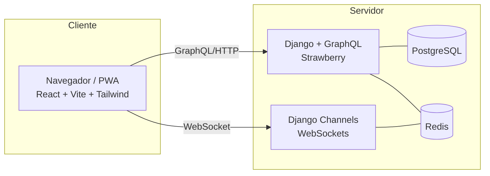

# Casa Rosa — Tecnologías y Despliegue

**Documento complementario a:** `Casa_Rosa_Definicion_Software.md`
**Objetivo de esta etapa:** desplegar una versión funcional para **pruebas durante ~1 mes**, con costo **gratis o casi gratis** y despliegue **lo más automático posible** (sin administrar servidores manualmente).

---

## 1. Stack elegido

Stack maduro y adecuado para el proyecto.

| Capa | Tecnología | Notas |
|------|-----------|-------|
| **Backend / API** | **Python + Django + GraphQL (Strawberry)** | API GraphQL para consultas y mutaciones del sistema. |
| **Tiempo real** | **Django Channels + Redis (WebSockets)** | Para cocina/caja en vivo. **No se usan GraphQL subscriptions** (ver sección 3). |
| **Frontend** | **React + Vite + Tailwind CSS** | PWA responsiva. Cliente GraphQL (Apollo Client o urql). |
| **Base de datos** | **PostgreSQL** | Relacional, ideal para pedidos, pagos y arqueos. |
| **Autenticación** | **django-allauth** (Google) + JWT/sesión (staff) | Login con Google; ver sección 3.1. |
| **Generación de QR** | Librería de QR en backend (ej. `qrcode`) | Genera el QR de cada mesa a partir de su URL. |

---

## 2. Arquitectura general

- **GraphQL (HTTP):** para casi todo (crear productos, pedidos, cobros, reportes) mediante queries y mutations.
- **WebSocket (Channels):** solo para lo que debe ser **instantáneo**: pedidos nuevos en cocina, cambios de estado, aviso de "Cobrar", aviso de "Listo".

---

## 3. El punto clave: tiempo real (y por qué no usar GraphQL para esto)

Django responde peticiones normales, pero el sistema necesita que **la cocina vea el pedido aparecer sin recargar**. Eso requiere **WebSockets**, resuelto con:

- **Django Channels** — agrega soporte de WebSockets a Django.
- **Redis** — reparte los mensajes en tiempo real entre usuarios conectados (y sirve de caché).

**¿Y las "subscriptions" de GraphQL?** GraphQL tiene un mecanismo propio para tiempo real (subscriptions), pero montarlo sobre Django es **más engorroso y frágil** que usar Channels directamente. Recomendación:

- **GraphQL** → para todas las consultas y mutaciones de datos (productos, pedidos, cobros, reportes).
- **Channels + WebSockets** → solo para los avisos en vivo (pedido nuevo, "Listo", "Cobrar").
- **No mezclar** GraphQL subscriptions con esto: se mantienen como dos canales separados y claros.

**Flujo ejemplo:** el cliente confirma su pedido (mutation GraphQL) → Django lo guarda en PostgreSQL → Django emite un mensaje por Channels/Redis → la pantalla de cocina (conectada por WebSocket) lo recibe al instante y suena la alerta.

> El uso de Channels implica que el backend corre en modo **ASGI** (no solo WSGI). Tenerlo en cuenta para la configuración del servidor.

### 3.1 Inicio de sesión con Google

La librería estándar es **django-allauth**, que trae el login con Google (y otros proveedores) listo: se configuran las credenciales de Google Cloud y funciona.

Como el frontend (React) está separado del backend, el patrón recomendado es:
- React inicia el login con Google y obtiene un **token**.
- Django **valida ese token** y crea/identifica al usuario (con `django-allauth` en modo headless, o apoyándose en `dj-rest-auth`).
- A partir de ahí, Django emite su propio token de sesión/JWT para las siguientes peticiones.

---

## 4. Despliegue recomendado (gratis / casi gratis, automático)

> **Recomendación:** **Railway** (backend + base de datos + Redis, todo junto) + **Vercel** (frontend React). Es la combinación con **menos pasos de configuración** y la más rápida de poner en línea.

### Opción recomendada: Railway + Vercel

| Pieza | Plataforma | Plan | Por qué |
|-------|-----------|------|---------|
| **Backend + PostgreSQL + Redis** | **Railway** (los tres juntos) | Crédito mensual gratis (~$5) | Todo en un solo lugar, interfaz visual simple, soporta WebSockets, despliega desde GitHub. Menos conexiones que configurar = menos errores. |
| **Frontend (React)** | **Vercel** | Gratis | Despliegue automático desde GitHub, ideal para Vite, HTTPS incluido. |

**Ventajas:**
- **Django + PostgreSQL + Redis en una sola plataforma** reduce la configuración de conexiones entre servicios.
- Despliegue **por GitHub**: `push` y se actualiza solo.
- Soporta **WebSockets** (cocina en vivo) sin configuración especial.
- **HTTPS gratis** (necesario para PWA, login con Google y cámara para escanear QR).
- No requiere administrar Linux, Docker ni Nginx.

> ⚠️ **Nota:** en Railway el plan gratis es un **crédito mensual** (~$5), no ilimitado. Suficiente para una prueba de 1 mes con poco tráfico. Para uso real continuo, conviene un plan de pago bajo.

---

## 5. Alternativa: Render + Neon + Upstash + Vercel

Si el crédito gratuito de Railway se queda corto, esta combinación se cambia **sin tocar el código** (solo variables de entorno):

| Pieza | Plataforma | Plan | Notas |
|-------|-----------|------|-------|
| **Backend (Django + Channels)** | **Render** | Gratis | Soporta ASGI/WebSockets, HTTPS automático, despliega desde GitHub. |
| **PostgreSQL** | **Render** o **Neon** | Gratis | Base gestionada con respaldos; Neon tiene plan gratis generoso. |
| **Redis** | **Upstash** | Gratis | Redis gestionado, se conecta por variable de entorno. |
| **Frontend (React)** | **Vercel** | Gratis | Igual que en la opción principal. |

> El plan gratuito de Render "duerme" tras inactividad (la primera carga tarda unos segundos en despertar). Aceptable para prueba; para producción real conviene un plan de pago bajo.

---

## 5.1 Orden de trabajo: primero LOCAL, luego despliegue

El desarrollo se hace **primero en local**; el despliegue es el último paso.

**Etapa 1 — Desarrollo local (la mayor parte del trabajo):**
- En la máquina de desarrollo corren: **Django + Channels**, **PostgreSQL**, **Redis** y **React (Vite)**.
- Se construye y prueba todo el sistema localmente, función por función.
- (Recomendado) usar **Docker / docker-compose** en local para levantar PostgreSQL y Redis, dejando el entorno muy parecido al de producción.

**Etapa 2 — Despliegue (último paso):**
- Con el sistema funcionando en local, se sube a **GitHub**.
- Se conecta el repo a **Railway** (backend + BD + Redis) y a **Vercel** (frontend).
- Se cargan las variables de entorno de producción.

> 🔑 **Clave para que local → producción sea indoloro:** **nada hardcodeado**. Contraseñas, URLs, claves y datos de conexión van en **variables de entorno**, tanto en local (`.env`) como en producción.

---

## 6. Variables y configuración

Para que el paso de local a producción sea ordenado, todo lo sensible o cambiante va en **variables de entorno** (no en el código):

- `DATABASE_URL` (PostgreSQL)
- `REDIS_URL` (Redis)
- `SECRET_KEY` de Django
- Credenciales de **Google OAuth**
- `ALLOWED_HOSTS` y dominios del frontend (CORS)
- Datos configurables del negocio (también pueden ir en la tabla `Configuracion`): costo de delivery, horarios, N° de WhatsApp, etc.

---

## 7. Pasos de despliegue (resumen, opción recomendada)

> Esto se hace **después** de tener el sistema funcionando en local (ver sección 5.1).

1. **Repositorios en GitHub:** uno para backend (Django) y uno para frontend (React), o un monorepo.
2. **Railway:** crear el proyecto y agregar **PostgreSQL** y **Redis** (servicios de un clic). Railway entrega sus URLs de conexión automáticamente.
3. **Backend en Railway:** conectar el repo, configurarlo como servicio **ASGI** (para Channels), cargar variables de entorno y correr migraciones.
4. **Frontend en Vercel:** conectar el repo, configurar la URL del backend.
5. **Google OAuth:** registrar la app en Google Cloud Console y autorizar los dominios del frontend/backend.
6. **Probar:** crear productos, generar QR de mesa, hacer un pedido de prueba y verificar que llega a cocina en vivo.

---

## 8. Recomendaciones adicionales

- **HTTPS obligatorio:** la cámara del celular (para escanear el QR) y el login con Google **solo funcionan sobre HTTPS**. Las plataformas sugeridas ya lo dan gratis.
- **Backups:** activar respaldo automático de PostgreSQL desde el primer día (Neon y Render lo ofrecen).
- **Zona horaria:** configurar Django con `TIME_ZONE = 'America/La_Paz'` y guardar en UTC, convirtiendo al mostrar (coherente con la definición del arqueo diario).
- **PWA:** configurar Vite como PWA para que el cliente pueda "instalar" el menú en su celular sin pasar por una tienda de apps.
- **Dominio:** para la prueba sirve el subdominio gratis que dan las plataformas (ej. `casarosa.vercel.app`). Para producción conviene un dominio propio (ej. `casarosa.com`), económico y más profesional para los QR.
- **Monorepo vs. repos separados:** para un equipo pequeño, **repos separados** (backend y frontend) suelen ser más simples de desplegar en plataformas distintas.

---

## 9. Resumen para el desarrollador

| Tema | Decisión |
|------|----------|
| Backend | Django + **GraphQL (Strawberry)** + **Channels + Redis** (tiempo real) |
| Login Google | **django-allauth** (no se programa desde cero) |
| Frontend | React + Vite + Tailwind (PWA) + cliente GraphQL (Apollo/urql) |
| Base de datos | PostgreSQL |
| **Hosting recomendado** | **Railway** (backend + PostgreSQL + Redis juntos) + **Vercel** (frontend) |
| Alternativa | Render + Neon + Upstash + Vercel (si el crédito de Railway se queda corto) |
| Tiempo real | Channels + WebSockets (NO GraphQL subscriptions) |
| Orden de trabajo | **Primero todo en LOCAL**, el despliegue es el último paso |
| Regla de oro | Nada hardcodeado: todo en variables de entorno (local y producción) |
| HTTPS | Incluido en las plataformas (obligatorio para cámara y Google login) |
| Zona horaria | `America/La_Paz`, guardar en UTC |
| Meta de esta etapa | Versión de prueba funcional por ~1 mes, gratis/casi gratis, despliegue automático por GitHub |
