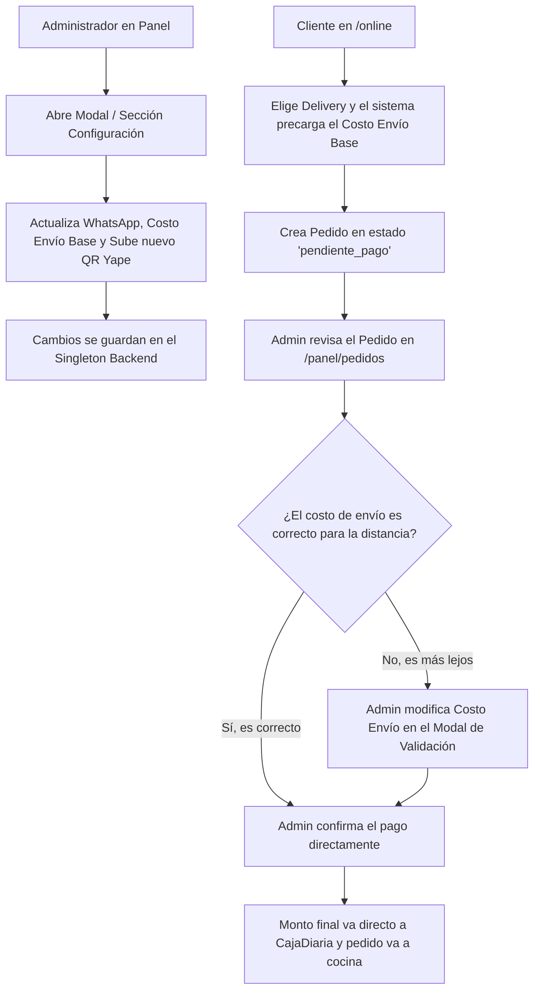

# Plan de Implementación Actualizado: Pedidos Online, Panel de Pedidos & Configuración Activa (Fase 2)

Hemos enriquecido la planificación para incluir las nuevas necesidades clave de personalización desde el panel administrativo:
1. **Configuración del Teléfono de WhatsApp**: Poder cambiar el número al que se enviarán las comandas en cualquier momento.
2. **Carga y Actualización Dinámica de la Imagen QR de Pago (Yape)**: Permitir subir una nueva imagen del código QR bancario desde el panel, almacenándola en el sistema.
3. **Costo de Envío Variable**:
   - **Configuración Base**: El admin define un costo base de delivery (ej: Bs 5.00) en el panel de configuración.
   - **Ajuste Dinámico por Pedido**: Al validar un pedido en `/panel/pedidos`, el cajero podrá **ajustar manualmente el costo de envío de ese pedido individual** (por si la distancia es mayor o hay recargos extraordinarios), recalculando el total antes de confirmar el pago y mandarlo a caja.

---

## 📌 Visión General de la Operación y Configuración

---

## 🗓️ Estructura de Sesiones (Actualizada y Detallada)

### 🔹 Sesión 1: Lógica de Negocio, Configuración de Sistema y GraphQL (Backend)
Habilitar las entidades, queries y mutations para la configuración dinámica y el soporte a pedidos online con costo de entrega flexible.

1. **Exposición del Singleton de Configuración**:
   - Crear el tipo de GraphQL `ConfiguracionType` que expone: `telefono_whatsapp`, `costo_delivery`, `qr_pago_url` (retorna el enlace de la imagen almacenada), y los horarios de atención.
   - Exponer la query `configuracion` para que el frontend (tanto de clientes como de administración) lea estos parámetros en tiempo real.
2. **Mutations de Configuración**:
   - `actualizarConfiguracion(telefonoWhatsapp: String, costoDelivery: Float, qrPath: String, horarioMananaInicio: String, horarioMananaFin: String, horarioTardeInicio: String, horarioTardeFin: String) -> ConfiguracionType`:
     - Permite al administrador actualizar cualquiera de los campos.
     - Si `qrPath` es proporcionado, se asocia directamente a la imagen de pago del negocio.
3. **Mutations para el Pedido y Flujo de Cobro Flexibilizado**:
   - `crearPedidoOnline(tipoEntrega: String!, costoEnvio: Float!, notaGeneral: String, detalles: [DetallePedidoInput!]!) -> PedidoType`:
     - Valida los horarios de atención.
     - Registra el pedido en `pendiente_pago` e inicializa el `Pago` con `confirmado=False`.
   - `confirmarPagoOnline(pedidoId: Int!, montoConfirmado: Float!, costoEnvioAjustado: Float) -> PedidoType`:
     - Busca la `CajaDiaria` abierta.
     - Si se provee `costoEnvioAjustado`, **actualiza el costo de envío del pedido** y recalcula su total.
     - Crea/Confirma el `Pago` asociado, registrando el `montoConfirmado` exacto directamente en la `CajaDiaria` del día.
     - Actualiza el estado a `pago_confirmado` y notifica a cocina (`_notificar_cocina`).
4. **WebSocket del Cliente**:
   - Canalización `ws/pedido/<int:pedido_id>/` para alertas dinámicas en el frontend del cliente.

---

### 🔹 Sesión 2: Interfaz del Cliente con Precarga Dinámica (Frontend `/online`)
Desarrollo de la experiencia pública del usuario final usando los parámetros cargados de la base de datos.

1. **Lectura Dinámica de la Tienda**:
   - Al cargar `/online`, el sistema consulta la configuración del negocio.
   - Se muestra el número de WhatsApp correspondiente en los enlaces de soporte.
   - Si está fuera de horario, se inhabilita el botón de compra con un banner amigable.
2. **Carrito Flexible**:
   - En la sección de Checkout, el costo del envío se precarga con el valor `costo_delivery` leído de la configuración.
3. **Pago Yape y Generación de WhatsApp**:
   - Al confirmar el carrito, se abre la pantalla de pago mostrando el **QR Yape cargado dinámicamente** desde el backend.
   - El botón de WhatsApp pre-diseña la comanda usando el número telefónico configurado por el administrador.
4. **Tracker en Tiempo Real**:
   - Seguimiento del estado del pedido a través del WebSocket individual.

---

### 🔹 Sesión 3: Nueva Sección Administrativa de Pedidos & Configuración (`/panel/pedidos`)
Creación del centro operativo del negocio que consolida los pedidos, los cobros personalizados y la configuración del local.

1. **Creación de `Pedidos.jsx` y su ruta**:
   - Sección principal **"📝 Pedidos"** accesible desde la barra lateral.
   - **Pestaña 1: Pedidos Online**:
     - **Solicitudes Entrantes** (`pendiente_pago`): Lista las solicitudes del exterior.
     - **Confirmación con Costo de Envío Flexible**: Al hacer clic en *"Confirmar Pago"*, se abre un modal que permite:
       1. Ver detalles de los ítems ordenados.
       2. **Ajustar el costo del delivery** (un campo editable pre-rellenado con el costo original). Si se cambia, se recalcula el total visual al instante.
       3. **Registrar el monto verificado del comprobante Yape**.
       4. Al guardar, se ejecuta `confirmarPagoOnline`, registrando el monto exacto en Caja e iniciando la preparación del pedido.
     - **En Cocina / Listos**: Pedidos activos con actualización mediante WebSocket y botón de despacho final (*"Marcar Entregado"*).
   - **Pestaña 2: Pedidos en Mesa (Salón)**: Listado estructurado de mesas, consumos acumulados y checkout directo para mesas físicas.
2. **Pestaña o Modal de Configuración del Negocio**:
   - Accesible para el administrador en `/panel/pedidos` o mediante un botón de engranaje ⚙️.
   - Formulario interactivo para cambiar:
     - Número de teléfono para WhatsApp.
     - Costo de envío base.
     - Subida de archivos para el QR Yape: utiliza el REST endpoint `api/upload-foto/` para almacenar la imagen y guarda la ruta en la configuración del backend.
     - Horarios de mañana y tarde.
3. **Limpieza de Caja y Validación General**:
   - `Caja.jsx` queda 100% limpia de pedidos individuales, mostrando de forma intachable el arqueo en vivo y los cierres históricos.

---

## 🔬 Plan de Verificación

1. **Subida de QR y Cambio de WhatsApp**: En el nuevo panel de configuración de administración, subir una imagen QR de prueba, actualizar el teléfono a uno ficticio y guardar. Verificar en la base de datos y en la query de configuración que los cambios se hayan guardado.
2. **Verificación en el Cliente**: Entrar a `/online` y comprobar que la imagen QR que se muestra sea la nueva cargada, y que el botón de WhatsApp apunte al nuevo número telefónico.
3. **Prueba de Delivery Variable**:
   - Crear un pedido online de delivery en `/online` (costo base Bs 5.00, total del pedido Bs 45.00).
   - En el panel de administración, abrir la solicitud, cambiar el costo del envío a `Bs 12.00` y confirmar un pago recibido de `Bs 57.00`.
   - Comprobar que en `/panel/caja` el monto sumado al reporte de arqueo por QR sea exactamente de `Bs 57.00`.
   - Verificar en KDS que la comanda online refleje el pedido para preparación.
