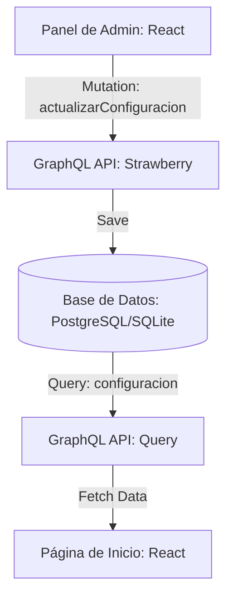

# Plan de Implementación: Personalización Dinámica de la Página de Inicio

Este documento detalla el plan de ingeniería para permitir que el administrador personalice la información de la página de inicio (dirección, Google Maps, WhatsApp, horarios y estacionamiento) desde el panel de administración.

---

## 🛠️ Arquitectura y Flujo de Datos



---

## 1. Cambios en el Backend (Django)

### A. Modificación del Modelo de Configuración
En `backend/configuracion/models.py`, añadiremos los siguientes campos al modelo `Configuracion` (que es un Singleton):

```python
# Django Fields
direccion_fisica = models.CharField(max_length=300, default='Av. Las Rosas #123, Zona Central, Bolivia')
horario_atencion = models.CharField(max_length=150, default='Lunes a Domingo: 8:00 AM – 10:00 PM')
google_maps_url = models.URLField(max_length=500, default='https://maps.google.com')
estacionamiento_detalle = models.CharField(max_length=200, default='Disponible frente al local')
```

### B. Actualización del Esquema GraphQL (Strawberry)
En `backend/configuracion/schema.py`, registraremos y mapearemos los nuevos campos en la API de GraphQL:
1. Agregar los nuevos campos al tipo de retorno `ConfiguracionType`.
2. Actualizar el mapeador helper `_to_type` para incluir los nuevos campos.
3. Extender la mutación `actualizar_configuracion` con los nuevos argumentos opcionales y el guardado en base de datos.

### C. Ejecución de Migraciones
Generar y aplicar la migración en el backend:
```bash
python manage.py makemigrations configuracion
python manage.py migrate
```

---

## 2. Cambios en el Frontend (React)

### A. Extensión de las Consultas GraphQL
En `frontend/src/graphql/configuracion.js`, añadir los nuevos campos tanto en `GET_CONFIGURACION` como en `ACTUALIZAR_CONFIGURACION`.

```graphql
# Campos a agregar a las queries/mutations
direccionFisica
horarioAtencion
googleMapsUrl
estacionamientoDetalle
```

### B. Creación de la Vista de Administración
Crear la nueva página de configuración `frontend/src/pages/admin/Configuracion.jsx`.
* Utilizará `<AdminLayout titulo="Configuración General">`.
* Consumirá la query `GET_CONFIGURACION` para precargar los datos del formulario.
* Implementará secciones para:
  1. **Datos de la Empresa**: Nombre del negocio, costo de delivery y carga del QR de pago.
  2. **Ubicación y Contacto**: Dirección física, enlace de Google Maps, número de WhatsApp y detalle del estacionamiento.
  3. **Horarios**: Campo descriptivo de horarios y selectores de rangos horarios de atención.
* Ejecutará la mutación `ACTUALIZAR_CONFIGURACION` al presionar "Guardar Cambios".

### C. Enrutamiento e Integración de Menú
1. **App.jsx**:
   * Importar el componente `Configuracion` desde `./pages/admin/Configuracion`.
   * Registrar la ruta privada:
     ```jsx
     <Route path="/panel/configuracion" element={<PermisoRoute codigo="gestionar_usuarios"><Configuracion /></PermisoRoute>} />
     ```
2. **AdminLayout.jsx**:
   * Añadir el item de configuración al arreglo `NAV_ITEMS`:
     ```javascript
     { to: '/panel/configuracion', label: 'Configuración', icon: '⚙️', permiso: 'gestionar_usuarios' }
     ```

### D. Vinculación Dinámica en la Página de Inicio
En `frontend/src/pages/Inicio.jsx`:
* Importar `useQuery` de `@apollo/client` y la consulta `GET_CONFIGURACION`.
* Reemplazar la constante estática `INFO_ITEMS` por datos obtenidos dinámicamente:
  ```javascript
  const { data } = useQuery(GET_CONFIGURACION)
  const conf = data?.configuracion
  
  const infoItems = [
    { icon: '📍', title: 'Dirección', detail: conf?.direccionFisica || 'Av. Las Rosas #123, Zona Central, Bolivia' },
    { icon: '📞', title: 'Contacto & WhatsApp', detail: conf?.telefonoWhatsapp || '+591 76543210' },
    { icon: '🕒', title: 'Horario de Atención', detail: conf?.horarioAtencion || 'Lunes a Domingo: 8:00 AM – 10:00 PM' },
    { icon: '🅿️', title: 'Estacionamiento', detail: conf?.estacionamientoDetalle || 'Disponible frente al local' },
  ]
  ```
* Enlazar el botón "Ver en Google Maps" y el enlace de "WhatsApp" a las variables dinámicas `conf?.googleMapsUrl` y `https://wa.me/${conf?.telefonoWhatsapp}` respectivamente.
